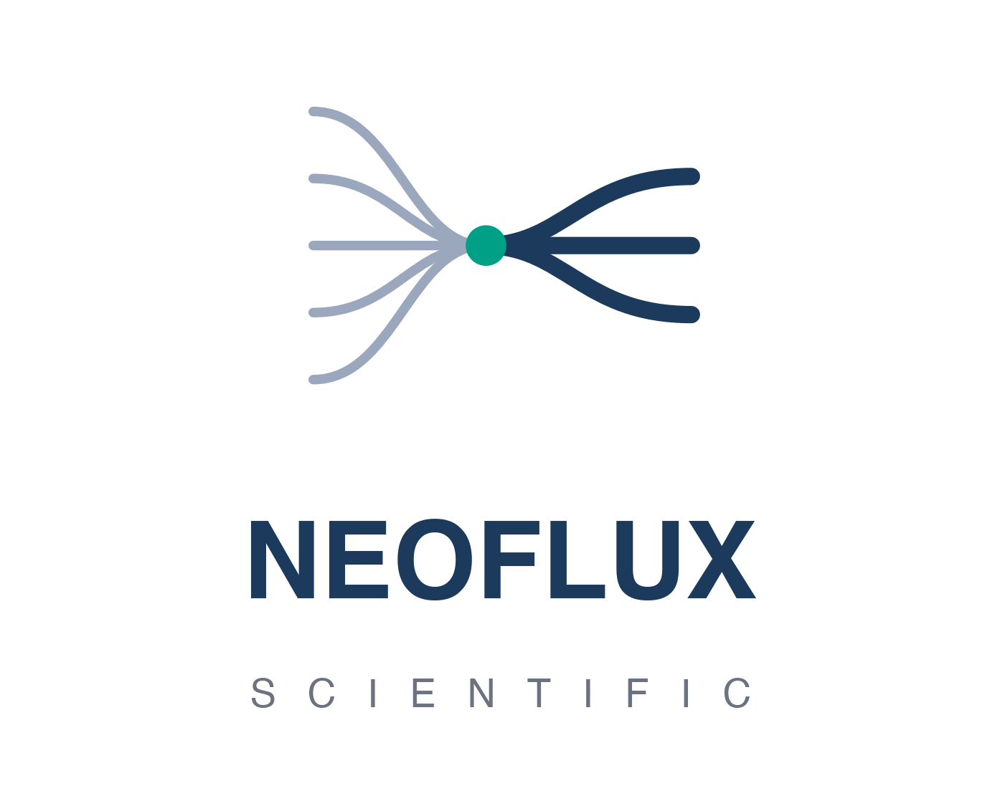
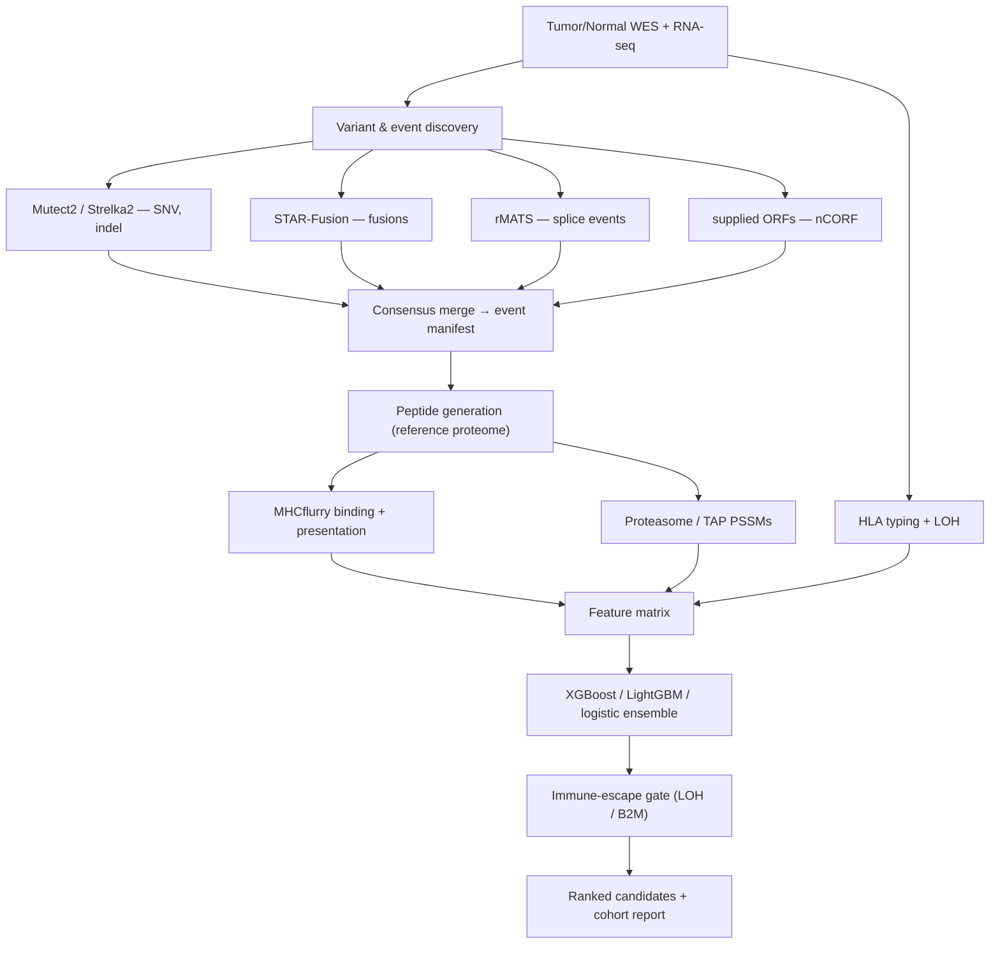

<div align="center">



# NeoFlux

**A unified pipeline for non-canonical neoantigen generation, antigen processing, and immune-escape–aware prioritization**

[](LICENSE)
[](https://www.python.org/)
[](https://www.nextflow.io/)
[](tests/)

*Presented at SITC 2026 — Sharma et al.*

</div>

---

## Overview

Standard neoantigen pipelines focus almost exclusively on single-nucleotide
variants (SNVs) from whole-exome sequencing — yet proteogenomic studies show
that a large fraction of tumor-specific antigens arise from **non-canonical
sources**: gene fusions, aberrant splicing, and non-canonical ORFs (nCORFs).
These novel sequences have no self-counterpart and escape central tolerance,
making them attractive immunotherapy targets.

**NeoFlux** generates and prioritizes neoantigen candidates across **six variant
classes** — SNV, indel, frameshift, fusion, splice, and nCORF — integrating MHC
binding, antigen processing, clonality, HLA loss-of-heterozygosity (LOH), and a
machine-learning ensemble trained on real IEDB T-cell assay data.

## Status & Capabilities

NeoFlux has two layers. To set expectations honestly:

### ✅ Candidate construction + prioritization — implemented, tested, validated

Given called variants/events, NeoFlux builds the **real peptides** and ranks them:

| Component | Implementation |
|---|---|
| Peptide construction | Canonical reference proteome (UniProt, cached) → real sequences across all six classes |
| MHC binding | **MHCflurry 2.2.1** (affinity + presentation) |
| Antigen processing | Proteasomal cleavage + TAP transport PSSMs |
| Ranking | XGBoost + LightGBM + logistic **ensemble** |
| Immune escape | Multiplicative HLA-LOH / B2M gate |

The ensemble is trained on **140,676 IEDB T-cell assay records**; on a held-out
test set (n = 28,136) it reaches **AUROC 0.76** vs. **0.54** for a
binding-affinity-only baseline (DeLong *p* < 0.001).

### ⚠️ Event discovery from raw sequencing — wired, not run here

The Nextflow modules invoke real tools (STAR-Fusion, rMATS, Mutect2/Strelka2,
OptiType), but running them needs the external tools, a genome-scale reference
stack (~100 GB), and real reads — none bundled here:

- **Fusion** and **splice** discovery are wired but unexercised with real data.
- **nCORF discovery is not implemented** (no Ribo-seq / ORF-calling module); ORF sequences must be supplied.
- **HLA LOH** uses a coverage-based heuristic, not the LOHHLA R tool.

> **In short:** NeoFlux is a working neoantigen **generation + ranking engine**.
> You supply the events; discovery-from-reads is a documented integration point,
> not a finished capability. The bundled demo runs the full generation + scoring
> path on a simulated 5-patient cohort.

## Key Results

**Model validation (held-out IEDB, n = 28,136):**

| Model | AUROC |
|---|---|
| NeoFlux ensemble | **0.76** |
| Binding affinity only (baseline) | 0.54 |

DeLong *z* = 59.2, *p* < 0.001. See [`models/publication_metrics.json`](models/publication_metrics.json).

**MHCflurry binding — strongest 8–11mer per variant class (simulated cohort):**

| Class | Peptide | Allele | IC50 (nM) | Presentation |
|---|---|---|---|---|
| SNV (EGFR G719S) | `VLSSGAFGTV` | HLA-A\*02:01 | **25.2** | 0.77 |
| Splice (MET ex14) | `SQNGSCRQVQY` | HLA-B\*15:01 | **58.0** | 0.82 |
| nCORF (LINE-1) | `STLNRQKSY` | HLA-B\*15:01 | 202.5 | 0.33 |
| Fusion (EML4-ALK) | `TVEPTPGKGPY` | HLA-B\*15:01 | 527.8 | 0.18 |

Full table: [`docs/mhcflurry_binding_results.tsv`](docs/mhcflurry_binding_results.tsv) ·
Figure: [`docs/figures/mhcflurry_binding.png`](docs/figures/mhcflurry_binding.png)

## Quickstart

```bash
# 1. Install (core + ML extras)
make install            # or: cd lib && pip install -e ".[ml]"
pip install mhcflurry && mhcflurry-downloads fetch models_class1_presentation

# 2. Run the 5-patient demo (construction + MHCflurry + ensemble scoring)
PYTHONPATH=lib python3 scripts/run_demo.py --output-dir demo_full
#   -> demo_full/<patient>/<patient>_ranked.tsv, cohort_summary.tsv, figures/

# 3. Run the tests
make test
```

The demo needs no genome, aligner, or Nextflow — it exercises the Python
pipeline directly and runs MHCflurry by default.

### Retraining on IEDB

```bash
# The IEDB export (tcell_full_v3.tsv, ~1.3 GB) is NOT bundled.
# Download from https://www.iedb.org/database_export_v3.php
PYTHONPATH=lib python3 scripts/prepare_training_data.py \
    --input-iedb-v3 tcell_full_v3.tsv --output training_iedb.tsv --compute-features
PYTHONPATH=lib python3 -c "from neoflux.training_data import train_publication_model as t; \
    print(t('training_iedb.tsv','models/publication_model.pkl','models/publication_metrics.json'))"
```

## Pipeline Architecture



## Repository Layout

```
lib/neoflux/          Python package (CLI, generators, features, ML ranker, evaluation)
modules/              Nextflow process modules (one per tool)
subworkflows/         Nextflow subworkflows
main.nf               Pipeline entry point
scripts/              Demo runner, training-data prep
tests/                pytest suite
assets/               Small demo inputs + cached reference proteome
models/               Trained ensemble + validation metrics
docs/                 Abstract, figures, binding results, logo
```

## License

Released under the [MIT License](LICENSE).

<div align="center">
<sub>NeoFlux Scientific · built for reproducible, open neoantigen discovery</sub>
</div>
